# Repository Architecture (`D:\remotionshorts`)

This document is the canonical structural and technical map of `remotionshorts` — a **Blender 4.2 LTS (`BLENDER_EEVEE_NEXT`) vertical 9:16 animated Shorts studio** with an Official 3D Mascot package, automated pre-render guardrails, three GPU execution backends, and a secondary Remotion + Three.js TypeScript engine.

For day-to-day agent rules and quickstart commands, start with [`AGENTS.md`](../AGENTS.md) and [`RICKS_STYLE_SKILL.md`](../RICKS_STYLE_SKILL.md).

---

## 1. High-Level Directory Map

```text
remotionshorts/
├── AGENTS.md                         # Master agent router (single source of truth)
├── CLAUDE.md / GEMINI.md / .cursorrules  # Thin pointers delegating to AGENTS.md
├── RICKS_STYLE_SKILL.md              # v7 Blender 4.2 visual, camera & directing spec
├── README.md                         # Project entry guide & quickstarts
├── requirements-blender.txt          # Python deps (numpy, Pillow) for Blender & QA tools
├── package.json / tsconfig.json      # Remotion TypeScript workspace config
│
├── assets/
│   └── mascot/                       # Official Main Character package (tracked in Git, auto-synced to Modal)
│       ├── mascot_master.blend       # Canonical 3D Mascot rig (<35k tris, 18 packed PNG decals)
│       ├── mascot_api.py             # load_mascot(), pose(), auto_lipsync(), attach_prop(), update_ink()
│       ├── anim_library.py           # 18 studio-ready S-curve actions with world-pinned stance feet
│       ├── starter_scene_template.py # Copy-and-edit 9:16 Short starter featuring the Mascot
│       ├── build_mascot_asset.py     # Deterministic procedural builder for mascot_master.blend
│       ├── expression_gen.py         # 2x supersampled Pillow generator for 12 expressions + 6 visemes
│       ├── MASCOT_SKILL.md / README.md
│       ├── expressions/              # 12 story PNGs + visemes/ (6 lip-sync PNGs)
│       └── previews/                 # 3 proof sheets (tracked) + demo MP4 (git-ignored)
│
├── scripts/                          # Core Blender kit, guardrails, QA, runners & active Shorts
│   ├── ricks_v2_kit.py               # Canonical 3D world, chiaroscuro lighting, PBR, character & camera kit
│   ├── ricks_camera.py               # Shot/CameraProgram tracks, beat_drift, handoff, lead, parallax
│   ├── ricks_drawn_look.py           # Opt-in drawn cel look (round/upright heads, paper-white preset)
│   ├── ricks_lookdev.py              # Internal legacy lookdev dependency (enter via ricks_v2_kit.py)
│   ├── ricks_guardrails.py           # Fast pre-render scene & expression guardrail module (pure-Python + bpy)
│   ├── shorts_preflight.py           # Visible triangle counter, texture sanitizer & camera clearance
│   ├── ricks_metrics_gate.py         # Edge density, camera velocity & word-sync numeric QA gates
│   ├── short_qa.py / shorts_qa_checks.py  # Post-render MP4 frame/luma/pop/freeze QA gate
│   ├── calibration_sheet.py          # Compact contact-sheet generator for visual review
│   ├── modal_blender.py              # Modal.com serverless NVIDIA L4/T4 headless EGL runner
│   ├── studio/set_ink.py             # Shared set-level ink helper
│   ├── templates/
│   │   ├── diorama_short_template.py # Flagship v7 starter (all 5 craft laws + guardrails wired in)
│   │   └── ricks_short_template.py   # Baseline & opt-in look/camera smoke starter
│   ├── <active_short>/v01/           # Active/paused productions (e.g. gold_mine_salting_10s/; finished shorts pruned cleanly after export)
│   └── *.mjs                         # Remotion render & framing helper scripts
│
├── tests/                            # Automated unit & opt-in smoke suites
│   ├── test_ricks_guardrails.py      # Pure-Python unit tests for scripts/ricks_guardrails.py
│   ├── test_ricks_kit_upgrades.py    # Pure-Python unit tests for v7 kit, camera & template upgrades
│   ├── test_mascot.py                # Mascot contract/math + headless Blender integration suite
│   ├── test_ricks_camera.py          # Camera program math tests
│   └── blender_optin_smoke.py        # 4-combination construction smoke check
│
├── docs/
│   ├── ARCHITECTURE.md               # This document
│   └── archive/                      # Quarantined legacy docs (BLENDER_SKILL, ANIMATION_STYLE_HANDOFF, etc.)
│
├── src/                              # Secondary Remotion + Three.js 2.5D TypeScript engine
│   ├── Root.tsx                      # Composition registry
│   ├── engine/                       # Shared ShortPlayer, character, camera, kit3d, shaders
│   └── videos/<short>/               # Individual Remotion compositions
│
├── tools/
│   └── blender_remote_bridge/        # Optional authenticated HTTP job queue for remote Blender GUI
│
├── animated-3d-story-video/          # Legacy Remotion/2.5D skill references
├── renders/ / out/ / output/         # Git-ignored local rendered outputs & proofs
├── refs/ / example-animation/        # Git-ignored local visual reference assets
└── _scratch/                         # Git-ignored quarantined scratch/temp workspace files
```

---

## 2. Module Dependency Graph

```mermaid
flowchart TD
    AGENTS["AGENTS.md (Master Router)"] --> SKILL["RICKS_STYLE_SKILL.md v7"]
    AGENTS --> MASCOT_SKILL["assets/mascot/MASCOT_SKILL.md"]

    subgraph Starters ["Runnable Starters & Productions"]
        DIORAMA["scripts/templates/diorama_short_template.py"]
        RICKS_TPL["scripts/templates/ricks_short_template.py"]
        MASCOT_TPL["assets/mascot/starter_scene_template.py"]
        PROD["scripts/<short>/v01/build.py"]
    end

    subgraph CoreKit ["Core Blender Kit & Assets"]
        KIT["scripts/ricks_v2_kit.py"]
        CAM["scripts/ricks_camera.py"]
        DRAWN["scripts/ricks_drawn_look.py"]
        LOOKDEV["scripts/ricks_lookdev.py (internal)"]
        MASCOT_API["assets/mascot/mascot_api.py"]
        ANIM_LIB["assets/mascot/anim_library.py"]
        MASTER["assets/mascot/mascot_master.blend"]
    end

    subgraph Quality ["Pre-Render Guardrails & Post-Render QA"]
        GUARD["scripts/ricks_guardrails.py"]
        PRE["scripts/shorts_preflight.py"]
        METRICS["scripts/ricks_metrics_gate.py"]
        QA["scripts/short_qa.py"]
    end

    subgraph Backends ["3 GPU Execution Backends"]
        LOCAL["1. Local RTX 3050 (.blender_gpu.lock)"]
        MODAL["2. Modal L4/T4 (scripts/modal_blender.py)"]
        SSH["3. Remote Linux / Colab SSH (BLENDER_EXE)"]
    end

    DIORAMA --> KIT
    DIORAMA --> CAM
    DIORAMA --> GUARD
    RICKS_TPL --> KIT
    RICKS_TPL --> DRAWN
    RICKS_TPL --> CAM
    MASCOT_TPL --> MASCOT_API
    MASCOT_TPL --> ANIM_LIB
    MASCOT_TPL --> KIT
    MASCOT_TPL --> GUARD
    PROD --> KIT
    PROD --> GUARD

    KIT --> LOOKDEV
    MASCOT_API --> MASTER
    ANIM_LIB --> MASCOT_API
    GUARD --> PRE

    PROD --> LOCAL
    PROD --> MODAL
    PROD --> SSH
    LOCAL --> METRICS
    MODAL --> METRICS
    SSH --> METRICS
    METRICS --> QA
```



> **Canonical Path Invariant:** `scripts/ricks_v2_kit.py`, `scripts/ricks_camera.py`, `scripts/ricks_drawn_look.py`, `scripts/ricks_guardrails.py`, `scripts/modal_blender.py`, `scripts/templates/`, and `assets/mascot/` MUST remain at these exact paths. Production scripts locate repo root via `(p / "scripts/ricks_v2_kit.py").is_file()`, and `scripts/modal_blender.py` uploads them via `CORE_PATTERNS`.

---

## 3. All Three GPU Execution Workflows

| Dimension | 1. Local PC + RTX 3050 (4 GB) | 2. Modal Serverless Cloud GPU | 3. Remote Linux / Colab SSH |
| :--- | :--- | :--- | :--- |
| **Runner / Entry** | Local `python build.py` spawning `BLENDER_EXE` | `modal run scripts/modal_blender.py` | Direct `blender -b` over SSH or `tools/blender_remote_bridge/` |
| **Blender Binary** | `BLENDER_EXE` env (`D:\tools\Blender\4.2.23\blender.exe` or PATH fallback) | `/opt/blender42/blender` (Blender 4.2.23, NVIDIA EGL) | `/opt/blender42/blender` (`BLENDER_EXE` env) |
| **Concurrency Guard** | Exclusive `.blender_gpu.lock` (`project`, `pid`, `owner`); no parallel Chromium | `max_containers=1`, `single_use_containers=True`; never touches local `.blender_gpu.lock` | Managed per remote host / bridge job queue (`.state/jobs`) |
| **Upload / Sync** | Direct local filesystem | Auto-bundles `CORE_PATTERNS` + `assets/mascot/` + ONE `--project` folder (`NEVER_UPLOAD` excludes `renders/`, `docs/`, `_scratch/`, `.git/`, `refs/`) | Manual git/rsync or authenticated HTTP bridge |
| **Outputs** | Direct to `renders/<short>/v01/` | Mirrored to `renders/<short>/v01/` + Modal volume `remotionshorts-outputs` | Remote path pulled back to local `renders/` |
| **Budget / Limits** | `<150k` tris, `<=2.0s/f`, `<=3.3 GiB` VRAM | L4 (`~$0.80/hr`) / T4 (`~$0.59/hr`), zero idle billing | Host-dependent (T4/L4/A100) |
| **Best Used For** | Quick local smoke tests & short calibration when local Blender is installed | Default heavy builds, Mascot renders, full 1080p MP4 renders | Persistent remote Linux/Colab sessions or GUI bridge inspection |

---

## 4. Official Main Character Package (`assets/mascot/`)

Our permanent Main Character is a 3-head-tall Chibi Mascot (`≈ 1.28 m` tall, `< 35,000` tris) with:
- **Head:** Snow-white AgX-compensated marshmallow head (`width_x = 0.440 m`, `depth_y = 0.400 m`, `height_z = 0.448 m`, strictly `1.00 <= H/W <= 1.05`) and `4°`-tilted crimson ribbed knit beanie.
- **Costume:** Oversized yellow hoodie with 3D neck/back collar, kangaroo pouch, metal eyelets, secondary-animated white drawstrings, selectable arms (`"hoodie"` | `"stick"`), selectable bottoms (`"pajamas"` | `"shorts"`), and chunky sneakers planted at `Z = 0.000 m`.
- **Decals & Poses:** 12 story expressions (`mascot_api.EXPRESSIONS`), 6 auto lip-sync visemes (`mascot_api.VISEMES`, driven by `hero.auto_lipsync(audio_path, f0, f1)`), 7 swappable 3D hand poses (`mascot_api.HAND_POSES`), world-pinned prop sockets (`hero.hand_socket_L` / `hand_socket_R` via `hero.attach_prop`), and 18 S-curve studio actions in `anim_library.py`.
- **Coordinate System:** Local `-Y` forward (`yaw = 0.0` faces camera at `-Y`), `L = -X`, `R = +X`, floor contact `Z = 0.000 m`.

---

## 5. Pre-Render Guardrails API (`scripts/ricks_guardrails.py`)

`scripts/ricks_guardrails.py` imports cleanly on host Python **without `bpy`** so unit tests and expression checks run on CPU, and executes full scene inspection when called inside Blender.

### Public API
- `audit_scene(scene, *, rigs=(), subjects=(), frames=None, expect_deep_focus=True, min_head_ratio=0.98, max_head_ratio=1.12, max_arm_stretch=1.25, max_leg_stretch=1.25, min_facing_dot=0.15, allow_back_view=(), margin=0.04, max_tris=150000) -> dict`
  - Returns `{"pass": bool, "issues": [{"check", "severity", "frame", "object", "detail", "fix_hint"}], "summary": {...}}`.
- `format_report(report) -> str` — crisp PASS/FAIL terminal summary with exact `FIX:` lines.
- Pure-Python primitives:
  - `check_head_ratio(width_m, height_m, *, min_ratio=0.98, max_ratio=1.12, obj_name="Head")`
  - `check_frustum_points(ndc_points, *, margin=0.04, obj_name="Subject", frame=1)`
  - `check_limb_stretch(actual_len, rest_len, *, max_ratio=1.25, obj_name="Limb", frame=1)`
  - `check_facing_dot(forward_xy, to_cam_xy, *, min_dot=0.15, obj_name="Actor", frame=1)`
  - `check_upper_face_pixel_lock(img_closed, img_open, *, split_y_frac=0.55, max_abs_diff=0)`

### Check Catalog
| Check Key | What It Prevents | Default Threshold |
| :--- | :--- | :--- |
| `head_ratio` | Squashed horizontal ovals or stretched heads | `0.98 <= H/W <= 1.12` |
| `frustum_clipping` | 9:16 edge clipping, bleed, or subject behind camera | NDC `x, y in [0.04, 0.96]`, `z > 0` |
| `limb_stretch` | Stretched noodle limbs, detached joints, collapsed curves | `actual / rest <= 1.25` |
| `facing_camera` | Blank back-of-head turned away from lens | `dot(fwd_xy, to_cam_xy) >= 0.15` (exempt via `allow_back_view`) |
| `upper_face_pixel_lock` | Syllable eye/brow flutter across lip-sync swaps | `max_abs_diff == 0` for `y < 55%` |
| `viewport_render_parity` | Hidden render-only objects, collections, or higher subsurf render levels | Exact parity on hide/show/subsurf |
| `eevee_contract` | Wrong engine, raytracing on, wrong resolution/fps, accidental DOF | `BLENDER_EEVEE_NEXT`, RT OFF, `1080×1920 @ 30fps`, `use_dof=False` |
| `triangle_budget` | RTX 3050 VRAM & frame-time blowups | Visible evaluated tris `< 150,000` |

---

## 6. Productions, Quarantined Docs & Reference Assets

- **Productions (`scripts/`):** Keep `scripts/` lean for reusable core kits, QA tools, `studio/`, `templates/`, and active/paused productions (`gold_mine_salting_10s/` — paused per `AGENTS.md`). Finished exported Shorts and pre-Nov-20 experiments have been pruned from the working tree (preserved in Git history prior to cleanup).
- **Quarantined Legacy Docs (`docs/archive/`):** Historical V13/flat-card specs (`BLENDER_SKILL.md`, `ANIMATION_STYLE_HANDOFF.md`, `PROJECT_MANIFEST.md`, `SHORTS_PIPELINE.md`). Never apply as default rules on new Shorts.
- **Visual Reference Catalog on Disk:**
  - `assets/mascot/previews/` — Mascot turnaround, 18-expression grid, 3 hero poses, demo reel.
  - `example-animation/` (git-ignored) — 8 style screenshots + `washroom_experiment_1080p.mp4`.
  - `refs/vendor/` (git-ignored, personal-use) — `ricksclips_v1.1/`, `tickingatlas_v12/`, `README_LOCAL.md`.
  - `character_sheet.png` (git-ignored) — School cast reference sheet.

---

## 7. `.gitignore` Asset Whitelisting Policy

- **Tracked in Git:** Code (`scripts/`, `src/`, `tests/`, `tools/`), documentation (`AGENTS.md`, `RICKS_STYLE_SKILL.md`, `docs/`), and lightweight canonical Mascot assets (`assets/mascot/*.blend`, `*.png`, `*.py`, `*.md`).
- **Ignored by Git:** Heavy videos and renders (`renders/`, `out/`, `output/`, `assets/**/*.mp4`, `*.mov`, `*.webm`), private/licensed references (`refs/`, `example-animation/`, `character_sheet.png`), voiceover audio (`public/*/audio.mp3`), secrets (`.env`, `~/.modal.toml`), Blender backups (`*.blend1`), and quarantined scratch (`_scratch/`, `tmp_scratch/`).

---

## 8. Secondary Engine: Remotion + Three.js (`src/`)

When a brief explicitly requests **Remotion** instead of Blender:
- **`src/engine/`:** Reusable 2.5D vertical story engine (`ShortPlayer.tsx`, `character.ts`, `pool.ts`, `camera.ts`, `kit3d.ts`, `shaders/`). See [`src/engine/README.md`](../src/engine/README.md).
- **`src/videos/<name>/`:** Self-contained modules (`story.ts`, `build.ts`, `world.ts`, `<Name>.tsx`) registered in `src/Root.tsx`.
- **Tooling:** `scripts/bridge-stills.mjs`, `scripts/bridge-video.mjs`, verified with `npx tsc --noEmit` and `scripts/short_qa.py`.
